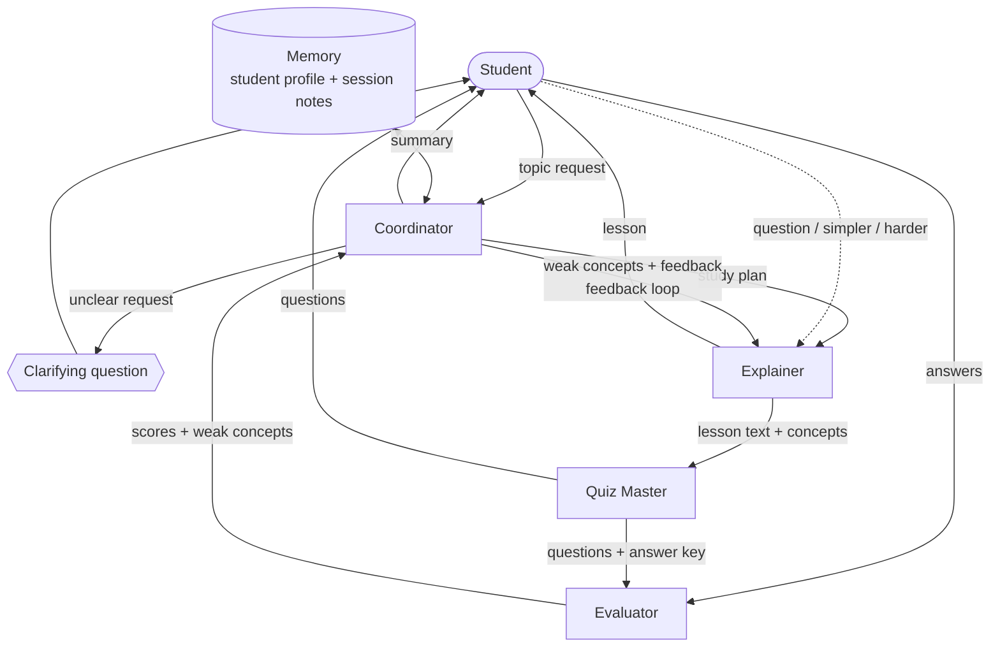

# Leo: Multi-Agent AI Tutor

Leo is a study assistant made of four agents built with CrewAI. The student picks a topic, and the agents plan, teach, quiz and give feedback, handing work to each other along the way. Leo runs in the terminal and shows which agent is working and every handoff between agents.

Model: Claude Haiku 5.5 (`anthropic/claude-haiku-5-5`) through CrewAI's Anthropic provider.

## The agents

| Agent | Role | What it produces |
| --- | --- | --- |
| Coordinator | Reads the student's request and memory, writes the study plan, asks a clarifying question when the request is unclear, decides when to re-teach, writes the closing summary. It never teaches or grades. | JSON study plan (`StudyPlan`), closing message |
| Explainer | Teaches the topic at the student's level, answers the student's questions during the lesson, and re-teaches weak concepts in a new way. | Markdown lesson |
| Quiz Master | Writes practice questions that test only what the Explainer taught, with an answer key. | JSON quiz (`Quiz`) |
| Evaluator | Grades the student's answers against the Quiz Master's key, writes feedback for each answer and lists weak concepts. | JSON evaluation (`Evaluation`) |

Each agent has its own role, goal and backstory in [leo/prompts.py](leo/prompts.py), and every task uses its own prompt template (`COORDINATOR_PLAN`, `EXPLAINER_LESSON`, `EXPLAINER_ANSWER`, `EXPLAINER_RETEACH`, `QUIZ_MASTER`, `EVALUATOR`, `COORDINATOR_WRAP_UP`).

## Architecture



Session flow:

1. The Coordinator greets the student. A returning student is recognised from memory.
2. The Coordinator turns the request into a study plan. A vague request ("science") gets a clarifying question. The student can accept the plan or change it.
3. The Explainer receives the plan and teaches. The student can ask questions or ask for a simpler or harder lesson before the quiz.
4. The Quiz Master receives the lesson and writes a quiz with an answer key. The student answers.
5. The Evaluator receives the quiz, the answer key and the student's answers, and returns scores, feedback and weak concepts.
6. Feedback loop: if the score is below the pass mark, the Evaluator's weak concepts go back through the Coordinator to the Explainer, who re-teaches them. The Quiz Master then gets the re-teaching as CrewAI task context and writes a short follow-up quiz, which the Evaluator grades again. This repeats up to two times.
7. The Coordinator writes a closing summary and saves progress to memory.

## Orchestration pattern

Sequential, led by the Coordinator. Each step is a CrewAI `Crew` with `Process.sequential`. Outputs are passed forward as real handoffs: the study plan goes into the Explainer's task, the lesson goes into the Quiz Master's task, and the quiz JSON with the answer key goes into the Evaluator's task. In the re-teach round the Explainer and the Quiz Master run in one crew, and the Quiz Master's task lists the Explainer's task in `context`, so CrewAI passes the re-teaching to it directly.

The steps run one after another rather than in a single crew because the student takes part between them (answering the quiz, asking questions, choosing to re-teach), and the Coordinator's routing decisions depend on the Evaluator's results.

## Memory

- Long term: [leo/memory.py](leo/memory.py) `StudentMemory` keeps each student's past topics, levels, scores and weak concepts in `.leo_memory.json`. The next session starts with "Welcome back" and the Coordinator plans with that history in mind.
- Short term: `SessionMemory` holds the student, topic, level and a running log of what each agent did. It goes into the Coordinator's and Explainer's prompts.

## Structured output

The Coordinator, Quiz Master and Evaluator return JSON that is checked against Pydantic models in [leo/schemas.py](leo/schemas.py). Each of these tasks has a CrewAI guardrail: if the JSON is invalid, the agent is told what was wrong and tries again (up to 2 times).

## Handling problems

- Unclear or off-topic request: the Coordinator asks one clarifying question instead of guessing, up to four times.
- Stalled agent: every crew runs with a timeout (180 seconds by default) and one retry. The Coordinator tells the student what happened.
- Agent still failing: the Coordinator falls back. No lesson means the quiz uses the plan's goals. No quiz ends the session politely. No Evaluator means multiple choice questions are graded with the Quiz Master's answer key.
- Bad JSON: guardrails ask the agent to fix it.
- Ctrl+C: the session stops and progress is saved.

## Human in the loop

The student can step in at three points: change the study plan before teaching starts, ask the Explainer questions or ask for a simpler or harder lesson before the quiz, and accept or skip the re-teaching round.

## How to run

Requires Python 3.10 to 3.13.

```bash
git clone https://github.com/Jahid15/leo-multi-agent-tutor.git
cd leo-multi-agent-tutor
python -m venv .venv
.venv\Scripts\activate        # Windows
source .venv/bin/activate     # macOS / Linux
pip install -r requirements.txt
cp .env.example .env          # then put your Anthropic API key in .env
python main.py
```

Add `--verbose` to see CrewAI's internal agent logs.

Settings in `.env`:

| Variable | Default | Meaning |
| --- | --- | --- |
| `ANTHROPIC_API_KEY` | | Your Anthropic API key (never committed) |
| `LEO_MODEL` | `anthropic/claude-haiku-5-5` | Model used by all agents |
| `LEO_AGENT_TIMEOUT` | `180` | Seconds before an agent is treated as stalled |
| `LEO_MAX_RETEACH_ROUNDS` | `2` | Feedback loop rounds |
| `LEO_PASS_MARK` | `0.7` | Score below which the Coordinator re-teaches |

## Project layout

```
main.py               entry point
leo/config.py         settings and the LLM
leo/prompts.py        role definitions and prompt templates
leo/agents.py         builds the four CrewAI agents
leo/orchestrator.py   the Coordinator's session flow, handoffs, feedback loop, error handling
leo/schemas.py        Pydantic models and JSON guardrails
leo/memory.py         long term and session memory
leo/ui.py             terminal interface
```

## Demo video

A 3 to 5 minute recording of one full session: [add link here]
